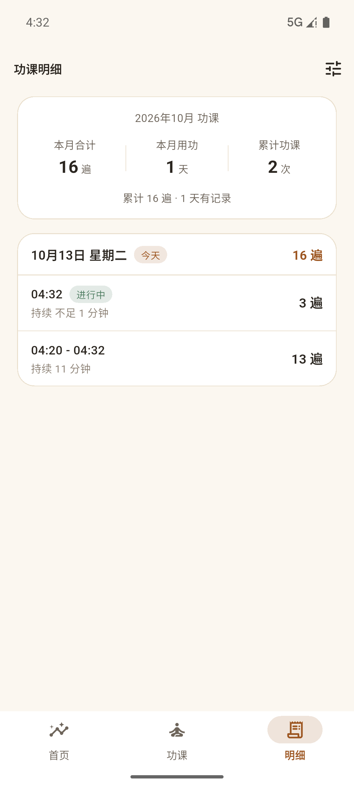
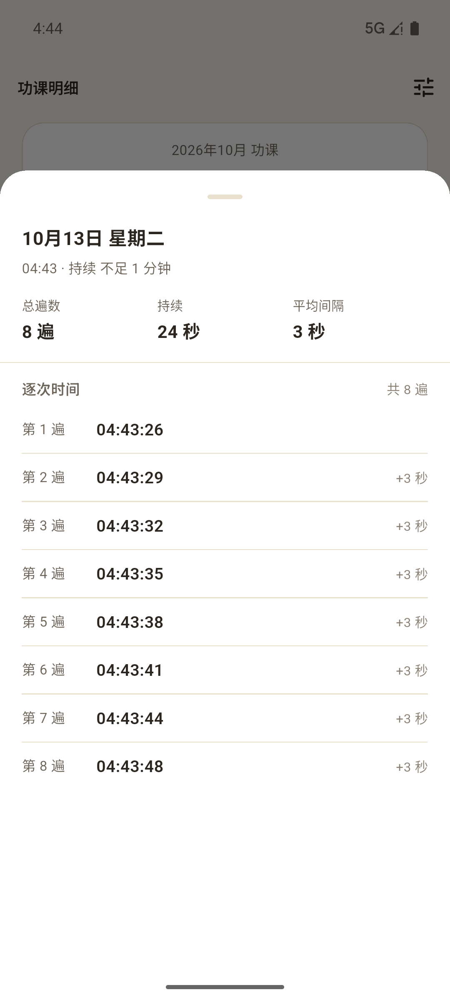
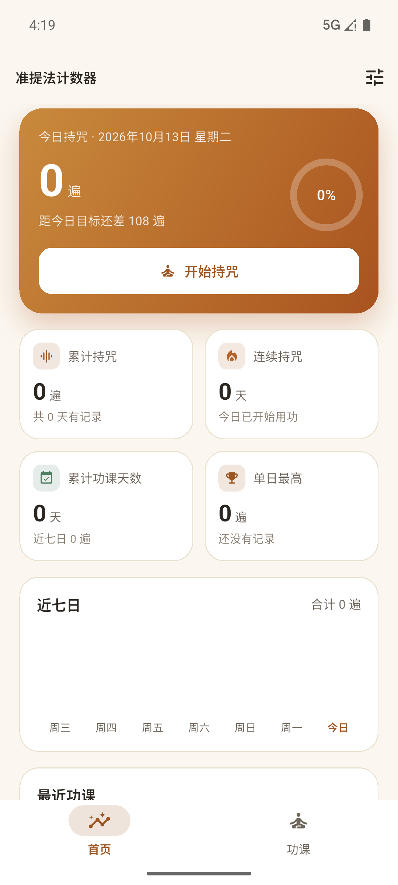
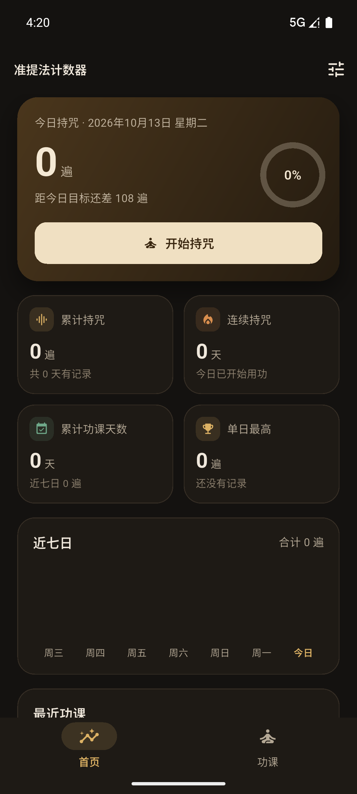
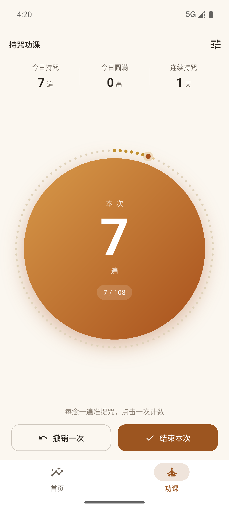
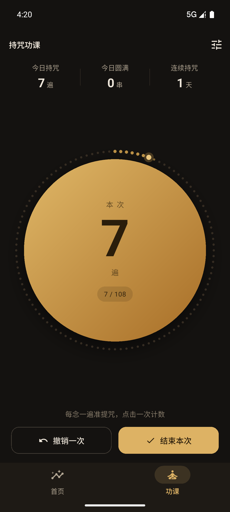

# 准提法计数器

一个帮助持诵准提咒的 Flutter 应用：每念一遍，点一次按钮记数，也可以开启语音自动计数；首页汇总功课统计。

支持 Android 与 iOS。

## 功能

### 功课页面

- **计数按钮**：点击一次记一遍，同时给出轻微震动与提示音反馈。
- **念珠表盘**：按钮外圈是一串念珠（默认 108 颗），实时显示本串进度；每圆满一串会有提示。
- **实时数据**：顶部显示今日持咒遍数、今日圆满串数、连续持咒天数。
- **语音自动计数**：打开「语音计数」后持续聆听，念满一遍准提咒自动记一遍。按拼音相似度比对——识别成同音字（「飒哆喃」听成「萨多南」）、个别字听错都能正确记数；只有念到结尾「准提娑婆诃」才算圆满，念到一半停下不会被误记。聆听时会回显最近识别到的内容；退到后台自动停止，不会一直占用麦克风。
- **撤销一次**：误触时可回退。
- **结束本次**：把当前这次功课归档为一条记录，计数归零。

### 首页

- **今日功课卡**：今日遍数、每日目标完成度环形进度、一键进入功课页面。
- **累计统计**：累计持咒遍数、连续持咒天数、累计功课天数、单日最高。
- **近七日柱状图**：直观看到近日用功情况。
- **最近功课**：最近 5 次功课的日期、时长与遍数。

### 明细页面



- **汇总**：本月合计遍数、本月用功天数、累计功课次数，以及累计遍数与有记录天数。
- **按天分组的记录**：日期倒序排列，每天一组，组内显示每次功课的时间段（`04:20 - 04:32`）、持续时长与遍数，组头是当天合计遍数。
- **今日 / 昨天 / 前天**有标记；正在进行中的那次功课会带上「进行中」标签。
- **点击任意一条记录**，可以看到这一次功课里**每一遍的具体时间点**。
- **删除单条记录**：向左滑动某条记录，或点开后在面板底部删除，确认后从统计中扣除；进行中的那一次可以在详情面板里「放弃本次功课」。首页「最近功课」右上角的「全部明细」可直接进入本页。

### 逐次持咒时间



点开明细里的某一条记录，会展开这一次功课的完整时间线：

- **顶部**：本次功课的日期、时间段与持续时长。
- **汇总**：总遍数、持续时长、平均间隔。
- **逐次时间**：从「第 1 遍」到最后一遍，逐条列出精确到秒的时间点，并标注与上一遍的间隔（`+3 秒`），方便回看当时的用功节奏。
- 每一遍的时间点在计数时就写进存档；升级前保存的记录没有这些数据，会明确提示「这条记录只有总遍数」，不会伪装成有时间点。
- 面板底部可以直接删除这条记录（进行中的那一次则是「放弃本次功课」）。

### 设置（右上角图标）

- 每日目标：21 / 54 / 108 / 216 / 432 / 1080 遍。
- 每串念珠颗数：18 / 21 / 27 / 54 / 108。
- 震动反馈、点击提示音开关。
- 界面皮肤：跟随系统 / 浅色 / 深色。
- 界面语言：跟随系统（默认）/ 简体中文 / 繁體中文 / English，切换后立即生效，并随功课数据一起保存。
- 备份与恢复：
  - **导出明细记录**：把全部记录（含进行中的一次）写成 JSON 备份文件，唤起系统分享面板，可保存到手机或发送到微信、邮箱、网盘。
  - **导入恢复**：从系统文件选择器中选中备份文件，预览将导入的条数与遍数，可选「合并」（按 id 去重追加）或「覆盖」（替换本地记录，有二次确认）。
- 清空全部记录。

## 两套皮肤

| | 浅色 · 宣纸檀金 | 深色 · 墨夜鎏金 |
| --- | --- | --- |
| 首页 |  |  |
| 功课 |  |  |

- 皮肤参数集中在 `lib/theme/app_skin.dart`，以 `ThemeExtension` 注入主题；页面统一通过 `AppSkin.of(context)` 取色，不再散落硬编码色值。
- 两套皮肤各自独立设计——渐变、念珠三态、投影都分别定过，不是同一套配色的明暗反转：
  - **浅色**：暖白宣纸底 + 檀褐主色，计数按钮是藏红实心渐变配白字。
  - **深色**：墨底暖光 + 鎏金主色，计数按钮是明亮黄铜配深墨字。
- 设置面板可切换皮肤，选择随功课数据一起持久化；切换即时生效且不影响正在进行中的计数。
- `test/app_skin_test.dart` 会校验两套皮肤的可读性对比度（正文、按钮、念珠、图表高亮），避免改配色后文字看不清。

## 多语言

界面文案放在 `lib/l10n/` 的 ARB 文件里，由 Flutter 的 `gen-l10n` 生成 `AppLocalizations`：

| 文件 | 语言 |
| --- | --- |
| `lib/l10n/app_zh.arb` | 简体中文（模板：新增文案先写在这里） |
| `lib/l10n/app_zh_Hant.arb` | 繁体中文 |
| `lib/l10n/app_en.arb` | 英语 |

- 生成结果在 `lib/l10n/gen/`（不入库）：`flutter pub get`、`flutter run`、`flutter test` 都会自动重新生成，也可以手动跑 `flutter gen-l10n`；生成配置见根目录 `l10n.yaml`。
- 界面里统一用 `AppLocalizations.of(context).xxx` 取文案，带数字的用占位符（如 `homeWeekCount(count)`）；英语的复数用 ICU 的 `plural` 写在 `app_en.arb` 里。
- 日期与时长由 `lib/utils/date_formats.dart` 统一输出：日期走 `intl` 的语言数据（繁体映射到 `zh_TW`，星期写作「週二」），「今天 / 昨天」「1 小时 20 分」这类说法走 ARB 文案。新增语言通常不用改这里。
- 语言选项在 `lib/l10n/app_language.dart`：`system`（跟随系统，默认）/ `zh` / `zhHant` / `en`。系统语言不在支持列表内时回退到简体中文（`l10n.yaml` 的 `preferred-supported-locales`）。
- 平台侧的应用名与语言声明：Android 的桌面名称在 `android/app/src/main/res/values*/strings.xml`，iOS 在 `ios/Runner/Info.plist` 的 `CFBundleLocalizations`（需与 `AppLocalizations.supportedLocales` 一致）。iOS 的桌面名称与权限说明（`NSMicrophoneUsageDescription`）要用 `InfoPlist.strings` 才能本地化，需在 Xcode 里为各语言新建 `.lproj` 资源，暂未处理。

### 新增一种语言

1. 复制 `lib/l10n/app_en.arb` 为 `app_<locale>.arb`（如 `app_ja.arb`），改掉 `@@locale` 与各条文案；
2. 在 `lib/l10n/app_language.dart` 的 `AppLanguage` 里加一个枚举值（枚举名就是存档里的取值），补上它的 `locale` 并加入 `options`；
3. 设置面板会自动出现新选项：它取 ARB 里 `languageXxx` 的文案，补上翻译即可；
4. 若该语言的日期数据在 `intl` 里需要特殊映射，在 `DateFormats._intlLocale` 补一条；
5. 需要的话同步 Android `values-<locale>/strings.xml` 与 iOS `CFBundleLocalizations`；
6. 跑 `flutter test`：`test/date_formats_test.dart` 与 `test/widget_test.dart` 覆盖了日期格式与语言切换。

> 测试约定：组件测试断言的是简体中文界面，所以用例里会把语言固定成 `AppLanguage.zh`——默认语言是「跟随系统」，而测试环境的系统语言不是中文。

## 运行

```bash
flutter pub get
flutter run                 # 连接设备或模拟器后运行
flutter test                # 运行单元测试与组件测试
flutter analyze             # 静态检查
```

### 在 Android 上运行（Windows）

Gradle 需要 **JDK 17+**；本机 `JAVA_HOME` 默认指向 Java 8，直接构建会在起步阶段失败（`Dependency requires at least JVM runtime version 11`）。把 Flutter 用的 JDK 指到本机的 JDK 17（只需设置一次）：

```powershell
flutter config --jdk-dir="E:\dev\ms-17.0.18"
```

也可以只在当前会话里临时覆盖：

```powershell
$env:JAVA_HOME = 'E:\dev\ms-17.0.18'
```

> JDK 必须是**完整版**（带 `jlink.exe`）。IDEA 自带的 `jbr` 等裁剪版会报 `jlink executable ... does not exist`；Java 26 则超出 Gradle 8.14 的支持范围。

启动模拟器并运行：

```powershell
flutter emulators --launch pixel36   # 本机模拟器 id，已在运行可跳过
flutter devices                      # 确认设备已连接，如 emulator-5554
flutter run -d emulator-5554         # 运行，支持热重载
```

不用 `flutter run`、直接把 debug 包装到模拟器：

```powershell
flutter build apk --debug
adb -s emulator-5554 install -r build\app\outputs\flutter-apk\app-debug.apk
adb -s emulator-5554 shell am start -n com.ngy.ngy_zhuntifa_counter/.MainActivity
```

打包：

```bash
flutter build apk --release          # Android
flutter build appbundle --release    # Android（上架 Google Play）
flutter build ios --release          # iOS，需要在 macOS 上执行
```

> iOS 首次构建时 Flutter 会自动生成 `ios/Podfile` 并执行 `pod install`。

### 发布构建包（GitHub Releases）

仓库自带 GitHub Actions 工作流（`.github/workflows/release.yml`）：

- **打标签自动发版**：推送 `v*` 标签会触发构建，完成后在仓库的 Releases 页面生成一条带 APK 的发行版，手机直接下载安装：

  ```bash
  git tag v1.0.0          # 版本号与 pubspec.yaml 保持一致
  git push origin v1.0.0
  ```

- **手动触发**：在仓库的 **Actions → Release APK → Run workflow** 手动运行；手动触发不会创建 Release，产物在本次运行的 Artifacts 里下载。
- 构建前会跑 `flutter analyze` 与 `flutter test`，测试不通过则不发布。
- 安装包使用正式签名（`android/app/build.gradle.kts` 读取 `android/key.properties`）：配好签名就用正式签名，未配置时回退调试签名，方便本地开发。
- CI 在海外运行，工作流里通过 `PUB_HOSTED_URL=https://pub.dev` 切回官方依赖源（本地锁文件用的是国内镜像）。

#### 正式签名

密钥库 `android/key/ngy-zhuntifa-release.p12`（PKCS12，别名 `ngy-zhuntifa`，有效期 30 年）与密码只保存在本地，已被 `.gitignore` 忽略，**务必另行备份**：丢失后无法再更新已发布的 App。

本地构建时新建 `android/key.properties`（同样不提交）：

```properties
storeFile=key/ngy-zhuntifa-release.p12
storePassword=<keystore 密码>
keyAlias=ngy-zhuntifa
keyPassword=<key 密码>
```

CI 发版时从 **Settings → Secrets and variables → Actions** 读取，需要 4 个 Secret：

| Secret | 内容 |
| --- | --- |
| `ANDROID_KEYSTORE_BASE64` | 密钥库文件的 Base64 文本 |
| `ANDROID_KEYSTORE_PASSWORD` | keystore 密码 |
| `ANDROID_KEY_ALIAS` | `ngy-zhuntifa` |
| `ANDROID_KEY_PASSWORD` | key 密码 |

生成 Base64：

```powershell
[Convert]::ToBase64String([IO.File]::ReadAllBytes('android\key\ngy-zhuntifa-release.p12'))
```

## 目录结构

```
lib/
  main.dart                     应用入口：加载数据后启动
  app.dart                      MaterialApp 与主题、语言装配
  home_shell.dart               底部导航框架（首页 / 功课 / 明细）
  l10n/
    app_zh.arb                  简体中文文案（模板）
    app_zh_Hant.arb             繁体中文文案
    app_en.arb                  英语文案
    app_language.dart           界面语言选项（跟随系统 / 简 / 繁 / 英）
    gen/                        由 ARB 生成，不入库（pub get 自动生成）
  models/
    practice_session.dart       一次功课记录（开始、结束、遍数、逐次时间偏移）
    practice_settings.dart      功课设置：皮肤与语言选择
  data/
    practice_store.dart         数据仓库：计数、撤销、归档、删除、导入导出、持久化
    practice_stats.dart         统计推导（今日/累计/连续天数/近七日）
    practice_history.dart       明细推导（按天分组与汇总）
    practice_backup.dart        明细记录的备份格式（编解码与校验）
    backup_error.dart           备份解析失败的原因与本地化映射
    key_value_store.dart        键值存储抽象（便于测试替换）
    practice_scope.dart         把仓库共享给组件树
  voice/
    mantra_matcher.dart         按拼音比对判断是否圆满一遍
    mantra_voice_counter.dart   语音识别控制器（持续聆听、静音续听）
    voice_failure.dart          语音失败原因与本地化映射
  pages/
    home_page.dart              首页：统计概览
    practice_page.dart          功课页：计数
    history_page.dart           明细页：按天列出每次功课
    settings_sheet.dart         功课设置面板
  widgets/
    practice_dial.dart          计数表盘与念珠绘制
    week_bar_chart.dart         近七日柱状图
    recitation_sheet.dart       逐次持咒时间面板
    stat_tile.dart              统计卡片
  theme/
    app_skin.dart               两套皮肤的色板与皮肤模式枚举
    app_theme.dart              由皮肤生成 Material 主题
  utils/date_formats.dart       按当前语言输出日期与时长
test/                           统计、仓库、皮肤、页面交互、语音、备份、日期与语言测试
assets/icon/app_icon.png        应用图标源图（换图后执行 `dart run flutter_launcher_icons` 重新生成）
l10n.yaml                       本地化生成配置（ARB 目录、模板、回退语言）
```

## 数据说明

数据保存在本机 `shared_preferences`（键名 `ngy_zhunti_practice_v1`，JSON 结构），不联网、不上传。

- 每次计数先在内存中生效并立即刷新界面，写入磁盘做了 600ms 防抖，应用退到后台时会立即落盘。
- **每一次持咒的时间点都会保存**：存的是相对本次功课开始时间的毫秒偏移（而不是绝对时间戳），可显著压缩体积。按每天 108 遍估算约 1.6 KB/天、1080 遍约 16 KB/天，长年累积请留意存档大小；如需按时间归档，可以再加保留策略。
- 进行中的功课也会保存，重新打开应用后可以接着计数。
- **跨天自动归档**：若在次日继续计数，上一天的功课会自动结为一条记录，归入原本的日期，统计不会串日。
- 统计口径：连续天数从今天（今天还没持咒时从昨天）往前累计，遇到没有记录的日子即停止。
- 兼容性：早期版本只记录了总遍数，这类记录仍能正常读取与统计，只是看不到逐次时间点。
- **导出与导入**：都走文件。「导出明细记录」把全部记录写成 JSON 文件并唤起系统分享面板，可保存到手机、发到微信/邮箱/网盘；「导入恢复」通过系统文件选择器选中备份文件，解析出预览后可选合并（按 id 去重追加）或覆盖（替换本地记录）。备份只含记录、不含设置。备份里的进行中功课会在本地没有正在进行的记录时恢复，不会打断当前计数。
- **语音计数**：应用只拿到系统识别出的文字做拼音比对，不保存、不上传任何音频。

## 备注

- 计数表盘在横竖屏下都会自适应尺寸；皮肤可跟随系统，也可在设置里锁定浅色或深色。
- 待办想法：念满整串时的磬声提示音、保持屏幕常亮、功课回向记录。这些都需要额外依赖，暂未引入。
